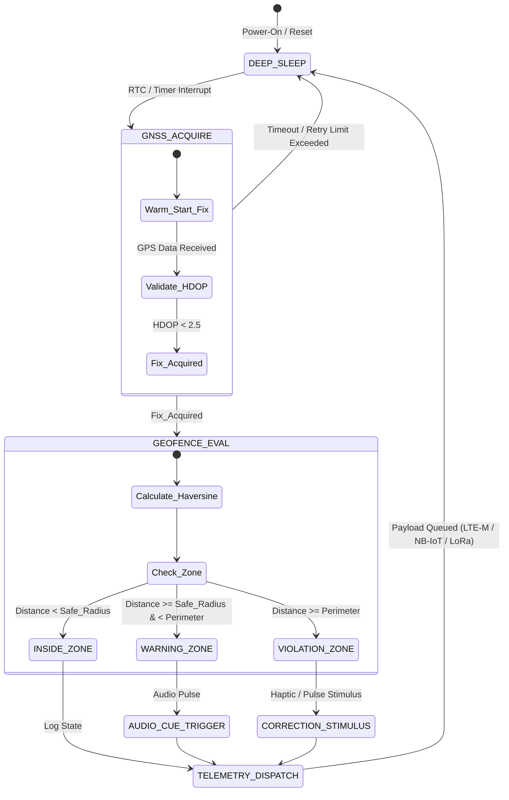

# DR-VF-01: Industrial IoT Virtual Fencing System for Precision Livestock Management

[]()
[_%7C_ESP32--S3_(final_PCB)-00a4e4.svg)]()
[]()
[]()
[](./docs/DR-VF-01_Memoria_Tecnica.pdf)
[]()

> **Production-grade Embedded System** designed for autonomous livestock monitoring, adaptive geofencing, and real-time containment metrics. Built on **Zephyr RTOS** as a single codebase for two boards: the **Nordic Thingy:91 X (nRF9151 Cellular IoT SiP + nRF5340 BLE/Network SoC, nRF Connect SDK)** as the proof of concept, and the **ESP32-S3-WROOM-1U-N16R8** on the final PCB (LoRa SX1262, external u-blox MAX-M10S GNSS, LSM6DSOX IMU).

---

## 📄 Full Technical Specification

The complete academic and industrial memory technical report (UNAL standard) detailing math models, RF link budget, thermal dissipation, and hardware schematics is available here:

👉 **[Download Full Technical Specification (PDF)](./docs/DR-VF-01_Memoria_Tecnica.pdf)**

---

## 🏗️ System Architecture

The firmware utilizes a non-blocking Finite State Machine (FSM) wrapped around a modular Hardware Abstraction Layer (HAL). This decouples the core **Geofence Mathematics Engine** from platform-specific SDKs. One **Zephyr RTOS** codebase runs on both boards: the geofence engine (`geofence.c`), the FSM and the logging layer are shared, while each board provides its own devicetree overlay, `prj.conf` and GNSS / communications / IMU adapters.



| Parameter | Specification | Engineering Note |
| :--- | :--- | :--- |
| **Proof-of-Concept Target** | Nordic Thingy:91 X (PCA20065) | nRF9151 (LTE-M/NB-IoT/GNSS) + nRF5340 (BLE), built with nRF Connect SDK |
| **Final Product Target** | ESP32-S3-WROOM-1U-N16R8 (custom PCB) | LoRa SX1262, external GNSS MAX-M10S, IMU LSM6DSOX. Pin map: `hardware/pinout.md` |
| **Operating System** | Zephyr RTOS (both boards) | Native DeviceTree & Kconfig driver architecture |
| **Shared / Per-Board Code** | Shared: `geofence.c`, FSM, logging | Per board: overlay, `prj.conf`, GNSS / comms / IMU adapters |
| **Geofencing Kernel** | Fixed-Point Haversine Algorithm | Zero Floating-Point Unit (FPU) overhead |
| **Power Consumption** | $< 15\,\mu\text{A}$ in Deep Sleep | Adaptive duty-cycling based on GNSS velocity |

## ⚙️ Engineering Trade-Offs & Design Decisions
### 1. Zephyr RTOS Portability via HAL
To ensure long-term industrial viability and prevent vendor lock-in, the codebase strictly isolates POSIX-compliant system calls and hardware drivers. Moving between the Nordic Thingy:91 X (proof of concept) and the ESP32-S3 PCB (final product) requires updating only the per-board devicetree overlay, `prj.conf` and the GNSS / communications / IMU adapters; 100% of the geofencing logic, FSM transitions, and risk metrics remain untouched.
### 2. Fixed-Point Math vs. Floating-Point Engine 
Calculations on embedded processors often suffer performance penalties when performing trigonometric operations (sin, cos, atan2) for GPS distances. The geofence engine relies on a custom fixed-point mathematical kernel (geofence.c), eliminating the need for dynamic memory allocation (malloc) and reducing calculation time per tick to under $1.2\,\text{ms}$.
### 3. Dynamic Power Budgeting 
Batteries in remote cattle collars cannot be replaced frequently. The firmware implements an adaptive sampling strategy:
- **Static Animal (IMU Stationary):** GNSS enters deep sleep; heartbeat telemetry sent every 6 hours.
- **Normal Grazing:** GNSS fix every 15 minutes.- 
- **Perimeter Boundary Approach:** GNSS fix interval ramps up dynamically to 5 seconds.
 
 ## 📂 Repository Structure
 ```
 Proyecto-DR-VF-01/
├── docs/                        # Specifications, Architecture, & Final PDF
│   ├── DR-VF-01_Memoria_Tecnica.pdf  <-- Full Compiled Technical Report
│   ├── 3_Firmware/              # Boot sequences, FSM logic, Risk evaluation
│   └── 5_Comercial/             # System Datasheet & User Manual
├── firmware/                    # Production Firmware Source Code
│   ├── include/drivers/         # Hardware Abstraction Layer API headers (geofence.h)
│   └── src/geofence/            # Core C Engine, Makefiles, & Unit Tests
├── hardware/                    # EDA Design Files (Altium / KiCad)
│   ├── gerber/                  # PCB Fabrication Files
│   ├── BOM.md                   # Bill of Materials
│   └── POWER_BUDGET.md          # Current Consumption Breakdown
├── mechanical/                  # Enclosure CAD & Environmental Tolerances
│   └── IP67_SPEC.md             # Ingress Protection Specifications
├── reports/                     # LaTeX Source Files (Modular LaTeX structure)
└── README.md                    # Project Entrypoint & Fictional Datasheet
```
## 🧪 Building & Running Firmware Unit Tests
The core geofencing algorithm contains standalone unit tests that can be compiled and executed locally on any Linux host system before flashing to hardware:
```
# Navigate to the geofence engine directory
cd firmware/src/geofence

# Compile and run the comprehensive test suite
make -f Makefile

# Run execution binary
./comprehensive_test
```
## 🛡️ License & Contact
Distributed under the MIT License. Developed by engineering team for UNAL academic defense and industrial remote deployment readiness.