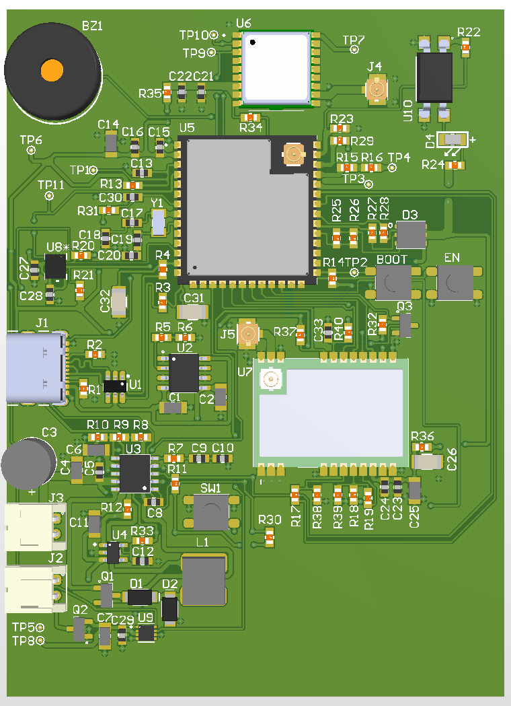
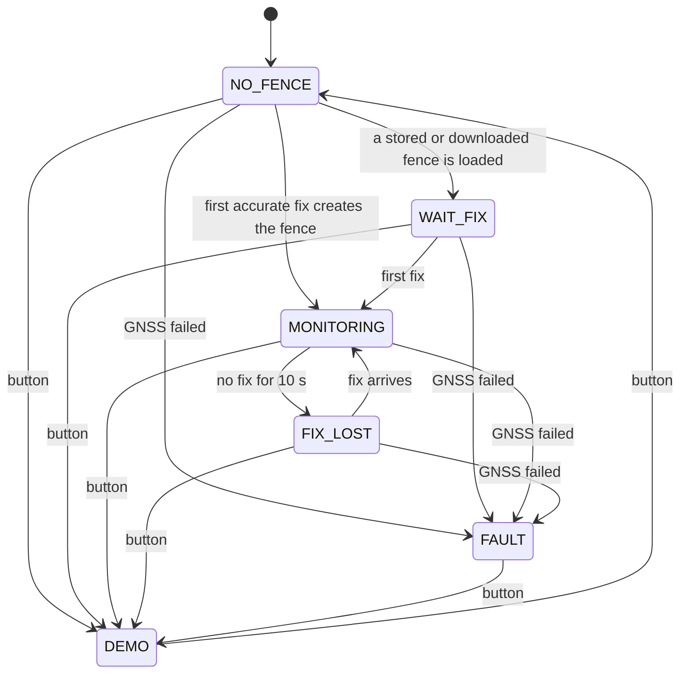

# DR-VF-01: Virtual Fencing Collar for Cattle

[](docs/poc-thingy91x/)
[](https://zephyrproject.org)
[](hardware/pcb/)
[](./LICENSE)

**A GNSS collar that tells a cow when it crosses a virtual boundary: no wire, no grid power.**
Embedded C firmware on Zephyr, proven on a Nordic Thingy:91 X, plus a custom ESP32-S3 PCB designed end to end in Altium.

<p align="center">
  
  <br>
  <em>Custom 2-layer PCB, 64.4 × 88.8 mm (2535 × 3496 mil), 112 placed parts</em>
</p>

[The problem](#the-problem) · [Highlights](#highlights) · [Quick start](#quick-start) · [Status](#status) · [Results](#results-so-far) · [Design decisions](#design-decisions) · [Documentation](#documentation) · [Build](#build-and-test) · [Limits](#known-limits) · [Author](#author)

## The problem

Extensive cattle ranching keeps animals inside paddocks with physical fences. A fence is fixed in the terrain and says nothing about where an animal is. This collar stores the boundary as a polygon, reads its own GNSS position and alerts when the animal reaches the edge. A small solar panel keeps the battery charged, so the collar needs neither wiring nor grid power.

## Highlights

- **Tested core.** A pure-C geofence engine: 350 µs per check with 4 vertices on the nRF9151, and 3,795,130 randomized host cases with 0 failures (also clean under ASan and UBSan).
- **One codebase, two boards.** The same engine and state machine run on the Thingy:91 X (working proof of concept) and on the custom ESP32-S3 PCB (designed), through hardware adapters.
- **Power-first hardware.** About 124 µA calculated in deep sleep against a 150 µA limit, and a 6 V solar charger with maximum power point tracking.
- **Engineering, not only code.** Requirements with a compliance matrix, a written application note for the PCB, and independent design reviews whose open findings are published.

## Quick start

The geofence engine builds and tests with `gcc` and `make` only (about 30 seconds):

```bash
git clone https://github.com/JavierAndresMunozAriza/Proyecto-DR-VF-01.git
cd Proyecto-DR-VF-01/firmware/src/geofence
make test      # 14 tests, 3,067 checks
make stress    # 3.8 million randomized cases
```

## Status

| Stage | What | State |
| :--- | :--- | :--- |
| 1. Rapid prototype | Geofence engine, state machine and RGB alert on the **Nordic Thingy:91 X** | Done and measured in the field. Report: [`docs/poc-thingy91x/`](docs/poc-thingy91x/) |
| 2. Custom PCB | 2-layer board, 5 schematic sheets, 64.4 × 88.8 mm | Designed, DRC with 0 violations, **not fabricated**. Outputs: [`hardware/pcb/`](hardware/pcb/) |
| 3. Firmware port | Same code on the ESP32-S3 with its own GNSS, LoRa and IMU adapters | Pending. Only compile-checked for the ESP32-S3 |
| 4. Fence from the cloud | Fence drawn in a local portal and delivered over LTE-M (nRF Cloud) | Host-tested and compiles. **Not run** on the board or against a cloud account |

## Results so far

Measured on the Thingy:91 X (nRF9151). These numbers do **not** describe the final PCB, which uses another MCU, GNSS receiver and antenna.

| Item | Result | Source |
| :--- | :--- | :--- |
| `geofence_check()` time | 350 µs with 4 vertices, 15.4 ms with 256, 61.4 ms with 1024; linear, so the 50 ms target (RF-02) is reached near 830 vertices | [Engineering Report](docs/poc-thingy91x/), `evidence/logs/geofence_benchmark.log` |
| Host tests of the engine | 3,067 checks plus 3,795,130 randomized cases, 0 failures; also clean under ASan and UBSan | `make test`, `make stress`, `make sanitize` |
| Distance accuracy | Worst error 0.021 % against the documented 0.2 % limit | Same report |
| Time to first fix, cold start | 54, 90 and 136 s (manual stopwatch, partial sky) | Same report |
| Position scatter, partial sky | CEP50 between 3.5 and 7.4 m against the 2.5 m target: **not met** in these conditions | Same report, [`docs/REQUIREMENTS.md`](docs/REQUIREMENTS.md) |
| Firmware footprint | 94,268 B flash (11.6 %), 19,776 B RAM (9.4 %) | Same report |
| PCB design rule check | 0 violations in all rules, including un-routed nets (2026-11-15) | [`hardware/pcb/`](hardware/pcb/) |

The report states what was *not* met and why. Compliance with each requirement is tracked in [`docs/REQUIREMENTS.md`](docs/REQUIREMENTS.md).

## Design decisions

The reasoning behind the hardware is documented with calculations in the [application note](docs/DR-VF-01_Nota_de_Aplicacion_PCB.pdf) (Spanish). The main choices:

| Decision | Why | Evidence |
| :--- | :--- | :--- |
| Pure-C engine behind hardware adapters | The same code runs on both boards and is tested on a PC | Host tests, `make cross-check` |
| Separate chargers for solar (CN3791, MPPT) and USB (TP4056) | With 5 V the solar charger's MPPT pin never reaches its 1.23 V start threshold (it needs more than 6.15 V at the input) | Application note, section 4.1 |
| TLV75733P LDO (25 µA) instead of the DS8570F8 (600 µA) | 24 times lower idle current; the sleep budget is about 124 µA against the 150 µA limit | Application note, sections 4.3 and 4.4 |
| ESP32-S3-WROOM-1U-**N16R2** | Rated 85 °C; the N16R8 is rated 65 °C, the design maximum, with no margin in a sealed enclosure | [`docs/design-reviews/bom.md`](docs/design-reviews/bom.md), finding BOM-04 |
| LoRa channel of 500 kHz inside 915.25 to 927.75 MHz | The first profile (fixed 915.0 MHz, SF12) fit no Colombian free-use category. Pending confirmation from the regulator before any field test | [`docs/design-reviews/rf.md`](docs/design-reviews/rf.md), finding RF-01 |
| Two-layer board with a continuous bottom ground plane | A 50 Ω microstrip (53 mil on 31.5 mil FR4) for the LoRa and GNSS lines keeps the board cheap | Application note, section 5 |

## How it works

The firmware is a small state machine around a pure-C geofence engine. Hardware access goes through adapters, so the same engine and state machine run on both boards.



On the Thingy the RGB LED shows the distance to the fence edge: green at 20 m or more, shifting to red near the edge, blinking red outside, blinking magenta if the signal is lost so that a lost signal is not mistaken for "outside". Button 1 plays a simulated walk so the alert can be shown indoors.

- `geofence.c` stays pure C (ray casting, no SDK dependency), so it is tested on the PC.
- Drivers use the Adapter pattern; each board has its own overlay, `prj.conf` and `gnss` / `comms` / `imu` adapters.
- On the Nordic board the GNSS runs inside the modem firmware and is reached through the `nrf_modem` library. On the ESP32-S3 the MAX-M10S will be a UART backend of the same adapter interface (design only, not implemented).

### Hardware at a glance (final PCB)

| Block | Choice |
| :--- | :--- |
| MCU | ESP32-S3-WROOM-1U-N16R2 |
| GNSS | u-blox MAX-M10S with a passive L1 patch on a u.FL cable |
| Radio | DX-LR30-900M22S (SX1262), 915 MHz band, u.FL monopole |
| Sensors | LSM6DS3TR-C IMU for wake-on-motion, MAX17048 fuel gauge |
| Power | 1S Li-ion; CN3791 charges from a 6 V solar panel, TP4056 from USB-C (500 mA); TLV75733P 3.3 V LDO. Deep-sleep budget about 124 µA (calculated) |
| Alert | Optocoupler output, LED and buzzer |

Details: [`docs/ARCHITECTURE.md`](docs/ARCHITECTURE.md), [`hardware/BOM.md`](hardware/BOM.md), [`hardware/pinout.md`](hardware/pinout.md), [`hardware/POWER_BUDGET.md`](hardware/POWER_BUDGET.md).

## Documentation

Start with the application note and the pitch; the rest is reference.

| Document | What it covers |
| :--- | :--- |
| [PCB application note](docs/DR-VF-01_Nota_de_Aplicacion_PCB.pdf) (Spanish, rev. 1.0; sources in [`reports/application_note_pcb/`](reports/application_note_pcb/)) | Design theory with calculations, layout, and a compliance table of the PCB against the requirements |
| [Pitch of the application note](docs/presentacion/README.md) (Spanish, 12 slides, 5 to 6 minutes) | One image per slide on GitHub, the PDF, a PowerPoint and the speaker script |
| Engineering Report, Thingy:91 X proof of concept ([ES](docs/poc-thingy91x/DR-VF-01_Engineering_Report_PoC_es.pdf), [EN](docs/poc-thingy91x/DR-VF-01_Engineering_Report_PoC_en.pdf)) | Acceptance criteria, method, measured results, compliance matrix and limitations of the prototype |
| [Technical Report](docs/DR-VF-01_Memoria_Tecnica.pdf) (Spanish) | The whole product: requirements, architecture, hardware, firmware, mechanics, compliance |
| [`docs/REQUIREMENTS.md`](docs/REQUIREMENTS.md) | Requirements (RF / RNF) with traceability and verification status |
| [`docs/design-reviews/`](docs/design-reviews/) | Independent reviews of the design (RF, BOM, power, MCU, firmware) with their findings and the decisions taken |
| [`hardware/pcb/`](hardware/pcb/) | Schematics, Draftsman drawing, BOM and Gerbers of the PCB |

## Repository map

```
docs/          Specifications, reports (PDF), design reviews and the pitch
firmware/      Geofence engine, application modules and the Thingy:91 X app
hardware/      BOM, pinout, power budget, thermal notes, PCB outputs, part libraries
mechanical/    Enclosure, IP67 and antenna placement notes
reports/       LaTeX sources of the reports and of the pitch
tools/         Local portal that draws the fence and sends it to nRF Cloud
odd/           Task logs of the development workflow
```

## Build and test

Host tests need only `gcc` and `make`:

```bash
cd firmware/src/geofence
make test          # unit tests
make stress        # ~3.8M randomized cases
make sanitize      # tests under ASan and UBSan
make cross-check   # compile the pure-C modules for the host, Cortex-M33 and ESP32-S3
```

Thingy:91 X app (needs nRF Connect SDK v3.4.1; the script handles a build path that contains spaces):

```bash
cd firmware
./build.sh         # build
./build.sh flash   # flash over USB-C (MCUboot)
./build.sh bench   # build the benchmark of geofence_check()
```

The GNSS needs open sky and a few minutes for a first fix. Host timing says nothing about the 50 ms target; that was measured on the board.

Rebuild the proof-of-concept report and recompute every figure from the evidence:

```bash
cd reports/engineering_report_poc
latexmk -pdf main_en.tex                 # or main_es.tex
python3 -I evidence/check_numbers.py
```

## Known limits

- The geofence engine uses `double` and allocates its vertex array with `malloc` / `realloc`. A fixed-point, allocation-free version is planned, not implemented.
- `geofence_distance_to_boundary()` is accurate up to 85° of latitude; the antimeridian is not supported.
- The PoC builds a 60 m square fence around the first fix. Defining the polygon by vertices is planned.
- LoRa, IMU wake-up and deep sleep exist only as designs in `docs/firmware_docs/`.
- The first PCB revision has no filter footprint in front of the GNSS input. The decision (a SAW footprint with a 0 Ω bypass in the next revision) is recorded in [`hardware/pinout.md`](hardware/pinout.md).

## Author

**Javier Andres Muñoz Ariza**, Electronic Engineering, Universidad Nacional de Colombia. GitHub: [@JavierAndresMunozAriza](https://github.com/JavierAndresMunozAriza) · LinkedIn: [Javier Andres Muñoz Ariza](https://www.linkedin.com/in/javier-andres-mu%C3%B1oz-ariza/).

Built with Zephyr RTOS, nRF Connect SDK v3.4.1 and Altium Designer. Firmware design patterns follow Elecia White, *Making Embedded Systems*; the structure of the reports follows Texas Instruments reference designs and an Infineon engineering report.

## License

MIT, see [LICENSE](./LICENSE).
