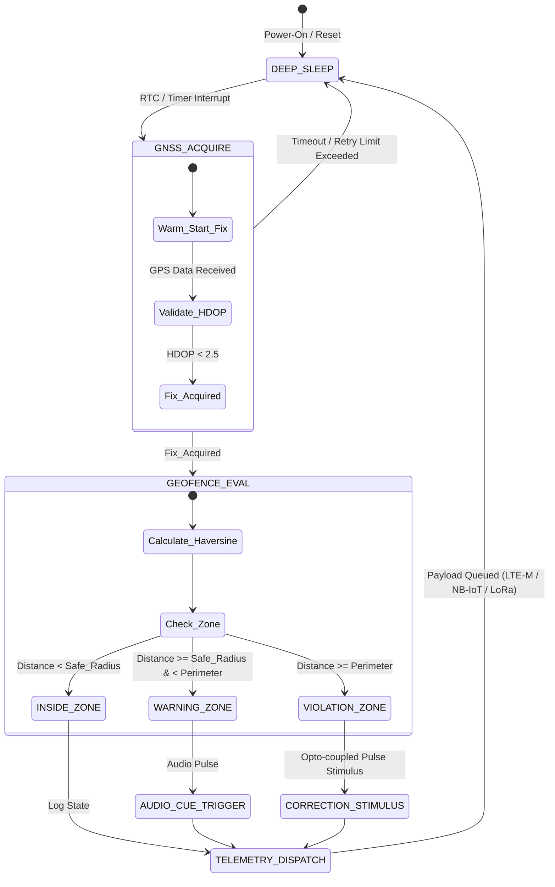

# DR-VF-01: Industrial IoT Virtual Fencing System for Precision Livestock Management

[]()
[_%7C_ESP32--S3_(final_PCB)-00a4e4.svg)]()
[]()
[]()
[](./docs/DR-VF-01_Memoria_Tecnica.pdf)
[]()

> **Embedded system under development** designed for autonomous livestock monitoring, adaptive geofencing, and real-time containment metrics. Built on **Zephyr RTOS** as a single codebase for two boards: the **Nordic Thingy:91 X (nRF9151 Cellular IoT SiP + nRF5340 BLE/Network SoC, nRF Connect SDK)** as the proof of concept, and the **ESP32-S3-WROOM-1U-N16R8** on the final PCB (LoRa module DX-LR30-900M22S with an SX1262 inside, external u-blox MAX-M10S GNSS, IMU POR DECIDIR: LSM6DSOX or the LSM6DS3TR-C the teacher has).

---

## 📄 Full Technical Specification

The complete academic and industrial memory technical report (UNAL standard) covering requirements, power budget, thermal dissipation, firmware architecture, enclosure tolerances and compliance is available here. An RF link budget and hardware schematics are planned and not yet part of the report:

👉 **[Download Full Technical Specification (PDF)](./docs/DR-VF-01_Memoria_Tecnica.pdf)**

---

## 🏗️ System Architecture

The firmware utilizes a non-blocking Finite State Machine (FSM) wrapped around a modular Hardware Abstraction Layer (HAL). This decouples the core **Geofence Mathematics Engine** from platform-specific SDKs. One **Zephyr RTOS** codebase runs on both boards: the geofence engine (`geofence.c`), the FSM and the logging layer are shared, while each board provides its own devicetree overlay, `prj.conf` and GNSS / communications / IMU adapters.



> **Note:** conceptual draft. The implemented geofence engine (`firmware/src/geofence/geofence.c`) decides inside/outside a polygon with ray casting; the radius zones and the warning zone drawn above are planned, not implemented. The state machine under design is in `docs/firmware_docs/FSM_DESIGN.md`.

| Parameter | Specification | Engineering Note |
| :--- | :--- | :--- |
| **Proof-of-Concept Target** | Nordic Thingy:91 X (PCA20065) | nRF9151 (LTE-M/NB-IoT/GNSS) + nRF5340 (BLE), built with nRF Connect SDK |
| **Final Product Target** | ESP32-S3-WROOM-1U-N16R8 (custom PCB) | LoRa module DX-LR30-900M22S (SX1262 inside, SPI), external GNSS MAX-M10S, IMU POR DECIDIR (LSM6DSOX or LSM6DS3TR-C). Pin map: `hardware/pinout.md`; parts list: `hardware/BOM.md` |
| **Power Path (final PCB)** | Battery-centred: CN3791 charges it from the 6 V solar panel only, TP4056 charges it from USB-C (500 mA); LDO TLV75733PDBVR (1 A, Iq 25 µA) feeds 3.3 V from the battery only | USB never powers the system. MAX17048 fuel gauge (I2C 0x36) on the battery rail; USBLC6-2SC6 ESD protection on the USB-C. Battery protection IC: POR DECIDIR (the BOM code BQ2975DRBR does not exist). Details: `docs/ARCHITECTURE.md` |
| **Antennas (final PCB)** | LoRa 915 MHz 8 cm u.FL monopole; 2.4 GHz FPC (Würth 2015301200, via u.FL) for the module's Wi-Fi/BLE; GNSS passive patch | GNSS patch MPN and antenna positions: POR DECIDIR (`hardware/BOM.md`, `mechanical/ANTENNA_PLACEMENT.md`) |
| **Operating System** | Zephyr RTOS (both boards) | Native DeviceTree & Kconfig driver architecture |
| **Shared / Per-Board Code** | Shared: `geofence.c`, FSM, logging | Per board: overlay, `prj.conf`, GNSS / comms / IMU adapters |
| **Geofencing Kernel** | Polygon ray casting in `double` (`geofence.c`) | Allocates the vertex array dynamically (`malloc` / `realloc`). A fixed-point, allocation-free kernel is planned, not implemented |
| **Power Consumption (target)** | About $124\,\mu\text{A}$ in Deep Sleep (calculated in `hardware/POWER_BUDGET.md`; requirement RNF-03: $< 150\,\mu\text{A}$), not yet measured | The margin is about $26\,\mu\text{A}$ and some consumers are still pending in the budget. Adaptive duty-cycling based on GNSS velocity is planned |

## ⚙️ Engineering Trade-Offs & Design Decisions
### 1. Zephyr RTOS Portability via HAL
To ensure long-term industrial viability and prevent vendor lock-in, the codebase strictly isolates POSIX-compliant system calls and hardware drivers. Moving between the Nordic Thingy:91 X (proof of concept) and the ESP32-S3 PCB (final product) requires updating only the per-board devicetree overlay, `prj.conf` and the GNSS / communications / IMU adapters; 100% of the geofencing logic, FSM transitions, and risk metrics remain untouched.
### 2. Floating-Point Engine Today, Fixed-Point Port Planned
Calculations on embedded processors often suffer performance penalties when performing trigonometric operations (sin, cos, atan2) for GPS distances. The geofence engine (`geofence.c`) currently uses `double` arithmetic with ray casting and allocates the vertex array dynamically (`malloc` / `realloc`). A fixed-point, allocation-free kernel is a planned optimization. No execution time has been measured on a target; the requirement is a processing time under 50 ms (RF-02).
### 3. Dynamic Power Budgeting 
Batteries in remote cattle collars cannot be replaced frequently. The firmware is designed to implement an adaptive sampling strategy (planned; the intervals below are under review and differ between documents):
- **Static Animal (IMU Stationary):** GNSS enters deep sleep; heartbeat telemetry sent every 6 hours.
- **Normal Grazing:** GNSS fix every 15 minutes.
- **Perimeter Boundary Approach:** GNSS fix interval ramps up dynamically to 5 seconds.
 
 ## 📂 Repository Structure
 ```
 Proyecto-DR-VF-01/
├── docs/                        # Specifications, Architecture, & Final PDF
│   ├── DR-VF-01_Memoria_Tecnica.pdf  <-- Full Compiled Technical Report
│   ├── PROJECT_CONTEXT.md       # Master document
│   ├── REQUIREMENTS.md          # Requirements matrix (RF / RNF) with traceability
│   ├── ARCHITECTURE.md          # Power topology, component calculations, firmware architecture
│   ├── firmware_docs/           # Boot sequences, FSM logic, Risk evaluation
│   └── comercial_docs/          # System Datasheet & User Manual
├── firmware/                    # Firmware source code (geofence engine so far)
│   ├── include/                 # Public C headers (geofence.h)
│   └── src/geofence/            # Core C Engine, Makefile, & Unit Tests
├── hardware/                    # Hardware design notes (no EDA files tracked yet)
│   ├── BOM.md                   # Bill of Materials
│   ├── COMPRAS.md               # Where to buy each part (sources and status)
│   ├── pinout.md                # Pin map
│   ├── POWER_BUDGET.md          # Current Consumption Breakdown
│   ├── THERMAL.md               # Thermal dissipation analysis
│   └── datasheets/              # Datasheet index
├── mechanical/                  # Enclosure specifications & Environmental Tolerances
│   ├── IP67_SPEC.md             # Ingress Protection Specifications (design target)
│   ├── ANTENNA_PLACEMENT.md     # Antenna placement
│   └── TOLERANCES.md            # Enclosure tolerances
├── reports/                     # LaTeX Source Files (Modular LaTeX structure)
└── README.md                    # Project Entrypoint & Fictional Datasheet
```
## 🧪 Building & Running Firmware Unit Tests
The core geofencing algorithm contains standalone unit tests that can be compiled and executed locally on any Linux host system before flashing to hardware:
```
# Navigate to the geofence engine directory
cd firmware/src/geofence

# Build and run the test suite (exits non-zero on any failed check)
make test
```
Timing printed by the host tests says nothing about the 50 ms requirement on the target; that needs a measurement on the board.

## 🛡️ License & Contact
Distributed under the MIT License (see [LICENSE](./LICENSE)). Developed by engineering team for UNAL academic defense and industrial remote deployment readiness.