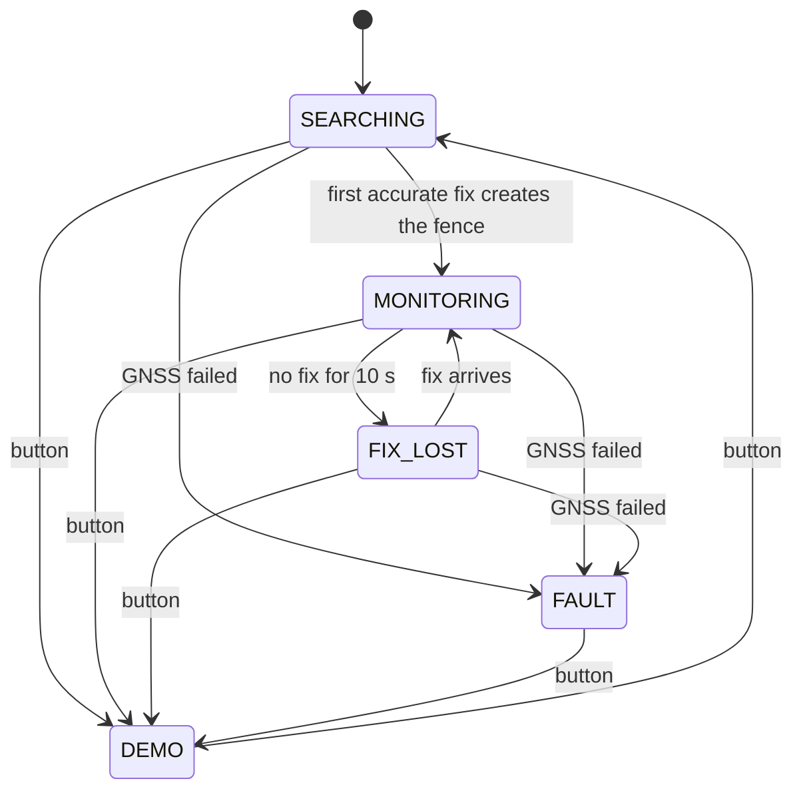

# DR-VF-01: Virtual Fencing Collar for Cattle

[]()
[]()
[]()
[](./LICENSE)

A GNSS collar that tells a cow when it crosses a virtual boundary, without a physical fence. The embedded C firmware runs on **Zephyr** and was proven on a Nordic Thingy:91 X (nRF9151). The custom PCB (ESP32-S3, u-blox MAX-M10S, LoRa SX1262) is fully designed in Altium and has not been fabricated yet.

## Status

| Stage | What | State |
| :--- | :--- | :--- |
| 1. Rapid prototype | Geofence engine, state machine and RGB alert on the **Nordic Thingy:91 X** | Done and measured in the field. Report: [`docs/poc-thingy91x/`](docs/poc-thingy91x/) |
| 2. Custom PCB | 2-layer board, 5 schematic sheets, 100 x 100 mm | Designed, DRC with 0 violations, **not fabricated**. Outputs: [`hardware/pcb/`](hardware/pcb/) |
| 3. Firmware port | Same code on the ESP32-S3 with its own GNSS, LoRa and IMU adapters | Pending. Only compile-checked for the ESP32-S3 |

## Results so far

Measured on the Thingy:91 X (nRF9151). These numbers do **not** describe the final PCB, which uses another MCU, receiver and antenna.

| Item | Result | Source |
| :--- | :--- | :--- |
| `geofence_check()` time | 350 µs with 4 vertices, 15.4 ms with 256, 61.4 ms with 1024; linear, so the 50 ms target (RF-02) is reached near 830 vertices | [Engineering Report](docs/poc-thingy91x/), `evidence/logs/geofence_benchmark.log` |
| Host tests of the engine | 3,067 checks plus 3,795,130 randomized cases, 0 failures; also clean under ASan and UBSan | `make test`, `make stress`, `make sanitize` |
| Distance accuracy | Worst error 0.021 % against the documented 0.2 % limit | Same report |
| Time to first fix, cold start | 54, 90 and 136 s (manual stopwatch, partial sky) | Same report |
| Position scatter, partial sky | CEP50 between 3.5 and 7.4 m against the 2.5 m target: **not met** in these conditions | Same report, `docs/REQUIREMENTS.md` |
| Firmware footprint | 94,268 B flash (11.6 %), 19,776 B RAM (9.4 %) | Same report |
| PCB design rule check | 0 violations in all rules, including un-routed nets (2026-11-15) | [`hardware/pcb/`](hardware/pcb/) |

The report states what was *not* met and why. Compliance with each requirement is tracked in [`docs/REQUIREMENTS.md`](docs/REQUIREMENTS.md).

## How it works

The firmware is a small state machine around a pure-C geofence engine. Hardware access goes through adapters, so the same engine and state machine run on both boards.



On the Thingy the RGB LED shows the distance to the fence edge: green at 20 m or more, shifting to red near the edge, blinking red outside, blinking magenta if the signal is lost so that a lost signal is not mistaken for "outside". Button 1 plays a simulated walk so the alert can be shown indoors.

- `geofence.c` stays pure C (ray casting, no SDK dependency), so it is tested on the PC.
- Drivers use the Adapter pattern; each board has its own overlay, `prj.conf` and `gnss` / `comms` / `imu` adapters.
- On the Nordic board the GNSS runs inside the modem firmware and is reached through the `nrf_modem` library. On the ESP32-S3 the MAX-M10S will be a UART backend of the same adapter interface (design only, not implemented).

## Design at a glance (final PCB)

| Block | Choice |
| :--- | :--- |
| MCU | ESP32-S3-WROOM-1U-N16R8 |
| GNSS | u-blox MAX-M10S with a passive L1 patch on a u.FL cable |
| Radio | DX-LR30-900M22S (SX1262), 915 MHz, u.FL monopole |
| Sensors | LSM6DS3TR-C IMU for wake-on-motion, MAX17048 fuel gauge |
| Power | 1S Li-ion; CN3791 charges from a 6 V solar panel, TP4056 from USB-C (500 mA); TLV75733P 3.3 V LDO. Deep-sleep budget about 124 µA (calculated, not measured) |
| Alert | Optocoupler output, LED and buzzer |

Details: [`docs/ARCHITECTURE.md`](docs/ARCHITECTURE.md), [`hardware/BOM.md`](hardware/BOM.md), [`hardware/pinout.md`](hardware/pinout.md), [`hardware/POWER_BUDGET.md`](hardware/POWER_BUDGET.md).

## Documentation

| Document | What it covers |
| :--- | :--- |
| [Technical Report](docs/DR-VF-01_Memoria_Tecnica.pdf) (Spanish) | The whole product: requirements, architecture, hardware, firmware, mechanics, compliance |
| Engineering Report, Thingy:91 X proof of concept ([ES](docs/poc-thingy91x/DR-VF-01_Engineering_Report_PoC_es.pdf), [EN](docs/poc-thingy91x/DR-VF-01_Engineering_Report_PoC_en.pdf)) | Acceptance criteria, method, measured results, compliance matrix and limitations of the prototype |
| [`docs/REQUIREMENTS.md`](docs/REQUIREMENTS.md) | Requirements (RF / RNF) with traceability and verification status |
| [`hardware/pcb/`](hardware/pcb/) | Schematics, Draftsman drawing, BOM and Gerbers of the PCB |
| [`docs/design-reviews/`](docs/design-reviews/) | Independent reviews of the design (RF, BOM, power, MCU, firmware) with open findings |

## Repository map

```
docs/          Specifications, reports (PDF) and design reviews
firmware/      Geofence engine, application modules and the Thingy:91 X app
hardware/      BOM, pinout, power budget, thermal notes, PCB outputs, part libraries
mechanical/    Enclosure, IP67 and antenna placement notes
reports/       LaTeX sources of the reports
odd/           Task logs of the development workflow
```

## Build and test

Host tests need only `gcc` and `make`:

```
cd firmware/src/geofence
make test          # unit tests
make stress        # ~3.8M randomized cases
make sanitize      # tests under ASan and UBSan
make cross-check   # compile the pure-C modules for the host, Cortex-M33 and ESP32-S3
```

Thingy:91 X app (needs nRF Connect SDK v3.4.1; the script handles a build path that contains spaces):

```
cd firmware
./build.sh         # build
./build.sh flash   # flash over USB-C (MCUboot)
./build.sh bench   # build the benchmark of geofence_check()
```

The GNSS needs open sky and a few minutes for a first fix. Host timing says nothing about the 50 ms target; that was measured on the board.

Rebuild the proof-of-concept report and recompute every figure from the evidence:

```
cd reports/engineering_report_poc
latexmk -pdf main_en.tex                 # or main_es.tex
python3 -I evidence/check_numbers.py
```

## Known limits

- The geofence engine uses `double` and allocates its vertex array with `malloc` / `realloc`. A fixed-point, allocation-free version is planned, not implemented.
- `geofence_distance_to_boundary()` is accurate up to 85° of latitude; the antimeridian is not supported.
- The PoC builds a 60 m square fence around the first fix. Defining the polygon by vertices is planned.
- Comms (LTE-M or LoRa), IMU wake-up and deep sleep exist only as designs in `docs/firmware_docs/`.

## License

MIT, see [LICENSE](./LICENSE). Academic project of the Universidad Nacional de Colombia.
