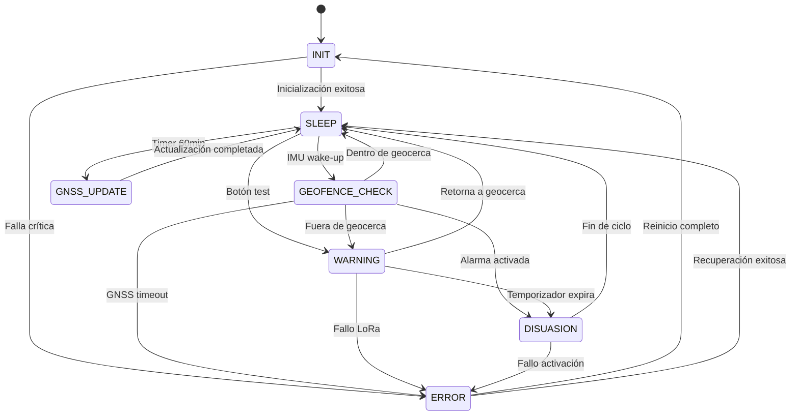

# Máquina de Estados Finitos (FSM)

## Descripción General

Esta documentación describe la máquina de estados finitos del sistema siguiendo los principios de diseño de sistemas embebidos descritos en "Making Embedded Systems" por Elecia White. El enfoque está en crear una arquitectura de estado robusta, predecible y mantenible.

*Nota: Este diseño de FSM implementa las mejores prácticas de arquitectura de sistemas embebidos según Elecia White: estados bien definidos, transiciones controladas y manejo de errores sistemático.*

## Principios Fundamentales de Diseño de FSM

### Arquitectura Basada en Estados
Siguiendo los principios de Elecia White:
1. **One state at a time** - Solo un estado activo en cualquier momento
2. **Explicit state transitions** - Cada transición debe ser claramente definida
3. **Error handling in every state** - Manejo de errores integrado en todos los estados
4. **Deterministic behavior** - Comportamiento predecible bajo todas las condiciones

### Estrategia de Transición
- **Event-driven transitions** - Cambios de estado basados en eventos específicos
- **Guard conditions** - Verificaciones previas a transiciones críticas
- **Timeout handling** - Gestión de tiempos máximos de espera
- **Fallback states** - Estados de recuperación para condiciones inesperadas

## Estados del Sistema

### 1. INIT (Inicialización)
- **Descripción**: Estado de arranque del sistema
- **Acciones**:
  - Ejecutar secuencia de boot completa
  - Inicializar periféricos y sensores
  - Cargar configuración de geocerca desde NVS
  - **Principio de Elecia White**: "Check everything twice" - Verificación redundante de inicialización
- **Transiciones**:
  - → SLEEP (tras 5 segundos de inicialización exitosa)
  - → ERROR (si falla cualquier componente crítico)
  - **Guard condition**: Todos los subsistemas deben pasar verificación de salud

### 2. SLEEP (Ahorro de Energía)
- **Descripción**: Estado de bajo consumo esperando eventos
- **Características**:
  - ESP32 en Deep Sleep mode
  - Solo IMU activa en modo low-power
  - GNSS en standby
  - **Principio de Elecia White**: "Minimize active time" - Reducción de consumo mediante sueño profundo
- **Eventos de Wake-up**:
  - Movimiento significativo detectado por IMU
  - Timer periódico (cada 60 minutos)
  - Interrupción externa (botón de test)
- **Transiciones**:
  - → GEOFENCE_CHECK (por IMU wake-up)
  - → GNSS_UPDATE (por timer)
  - → WARNING (por botón de test)
  - **Timeout**: Auto-wake cada 24 horas para verificación de salud

### 3. GEOFENCE_CHECK (Verificación de Geocerca)
- **Descripción**: Evaluación de posición dentro de límites
- **Secuencia**:
  1. Activar GNSS para obtener posición
  2. Esperar fix válido (timeout: 30 segundos)
  3. Ejecutar algoritmo Point-in-Polygon
  4. Evaluar resultado contra geocerca almacenada
  5. **Logging**: Registrar resultado en log circular
- **Transiciones**:
  - → WARNING (posición fuera de geocerca)
  - → DISUASION (alarma activada)
  - → SLEEP (posición dentro de límites)
  - → ERROR (GNSS timeout)
  - **Principio de Elecia White**: "Log everything" - Registro detallado de eventos

### 4. WARNING (Alerta de Salida)
- **Descripción**: Posición fuera de geocerca detectada
- **Acciones**:
  - Activar señal de advertencia (LED rojo parpadeante)
  - Preparar mensaje LoRa con coordenadas
  - Iniciar temporizador de disuasión (10 segundos)
  - **Safety mechanism**: Verificación de condiciones antes de disuasión
- **Transiciones**:
  - → DISUASION (temporizador expira)
  - → SLEEP (animal retorna a geocerca)
  - → ERROR (fallo en transmisión LoRa)
  - **Principio de Elecia White**: "Design for safety" - Verificación antes de acciones críticas

### 5. DISUASION (Activación de Disuasión)
- **Descripción**: Activación del mecanismo de disuasión
- **Acciones**:
  - Activar optoacoplador VO617A
  - Emitir pitido de advertencia (buzzer)
  - Transmitir mensaje LoRa de alerta crítica
  - **Safety timeout**: Limitación de duración máxima
- **Duración**: 5 segundos máximos
- **Transiciones**:
  - → SLEEP (fin de ciclo de disuasión)
  - → ERROR (fallo en activación)
  - **Principio de Elecia White**: "Limit dangerous actions" - Control de duración de acciones críticas

### 6. GNSS_UPDATE (Actualización Periódica)
- **Descripción**: Actualización de posición programada
- **Frecuencia**: Cada 60 minutos
- **Acciones**:
  - Obtener posición precisa
  - Enviar telemetría de salud del sistema
  - Actualizar timestamp en memoria
  - **Health check**: Verificación de todos los subsistemas
- **Transiciones**:
  - → SLEEP (operación completada)
  - **Principio de Elecia White**: "Regular health checks" - Monitoreo continuo del sistema

### 7. ERROR (Manejo de Errores)
- **Descripción**: Estado de recuperación de errores
- **Acciones**:
  - Registrar error en log circular
  - Reiniciar periféricos afectados
  - Intentar recuperación automática
  - **Principio de Elecia White**: "Graceful degradation" - Degradación controlada
- **Transiciones**:
  - → INIT (reinicio completo si persiste)
  - → SLEEP (recuperación exitosa)
  - **Safety mechanism**: Contador de intentos para evitar loops infinitos

## Diagrama de Transición de Estados

## Consideraciones de Tiempo Real

### Restricciones Temporales Críticas
- **WCET PIP Algorithm**: < 50ms (ver `docs/firmware_docs/REAL_TIME_RISKS.md`)
- **GNSS Fix Timeout**: 30 segundos máximo
- **LoRa Transmission**: < 2 segundos (SF12, 125kHz)
- **Deep Sleep Current**: < 5μA

### Estrategia de Manejo de Tiempos
Siguiendo los principios de Elecia White:
1. **Deadline awareness** - Conciencia constante de tiempos críticos
2. **Timeout mechanisms** - Mecanismos de timeout en todas las operaciones
3. **Priority inheritance** - Herencia de prioridad para prevenir inversiones
4. **Watchdog integration** - Integración con watchdog para supervisión

## Conclusiones

Esta máquina de estados finitos proporciona una arquitectura robusta para el collar DR-VF-01 que:

1. **Sigue principios de diseño probados** de Elecia White para sistemas embebidos confiables
2. **Maneja errores de forma proactiva** con estados dedicados y mecanismos de recuperación
3. **Optimiza el consumo energético** mediante estados de sueño profundo bien definidos
4. **Proporciona visibilidad completa** del sistema mediante logging detallado
5. **Mantiene predictibilidad** bajo condiciones normales y excepcionales

El diseño asegura operación estable en el campo mientras permite diagnóstico y mantenimiento eficientes.

## Estrategia de Logging y Diagnóstico

### Registro de Estados
Cada transición de estado se registra con:
- Timestamp preciso
- Estado origen y destino
- Condiciones que provocaron la transición
- Métricas de rendimiento relevantes

### Diagnóstico Proactivo
- **State counters**: Contadores de entradas a cada estado
- **Error tracking**: Seguimiento de errores por tipo y frecuencia
- **Performance metrics**: Métricas de tiempo de ejecución
- **Resource monitoring**: Uso de memoria y CPU
