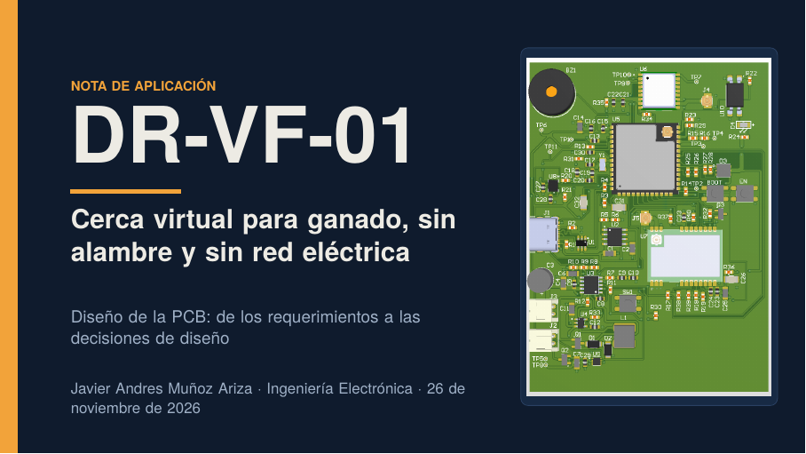
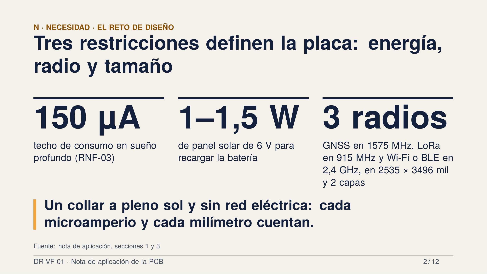
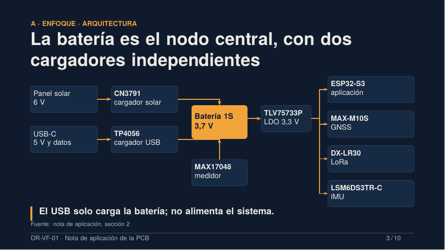
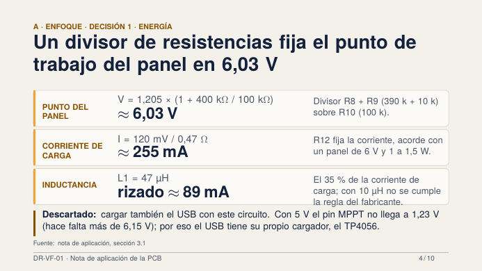
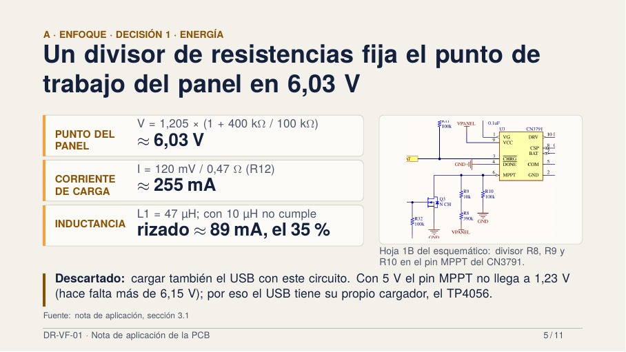
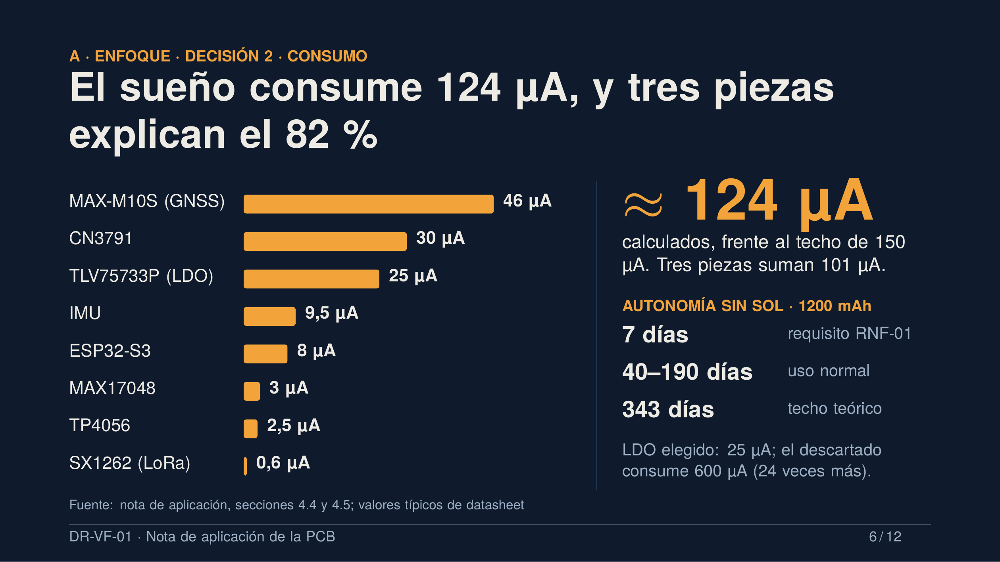
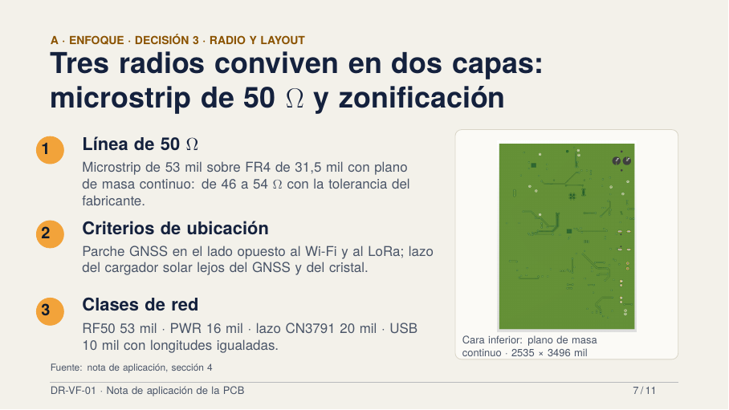
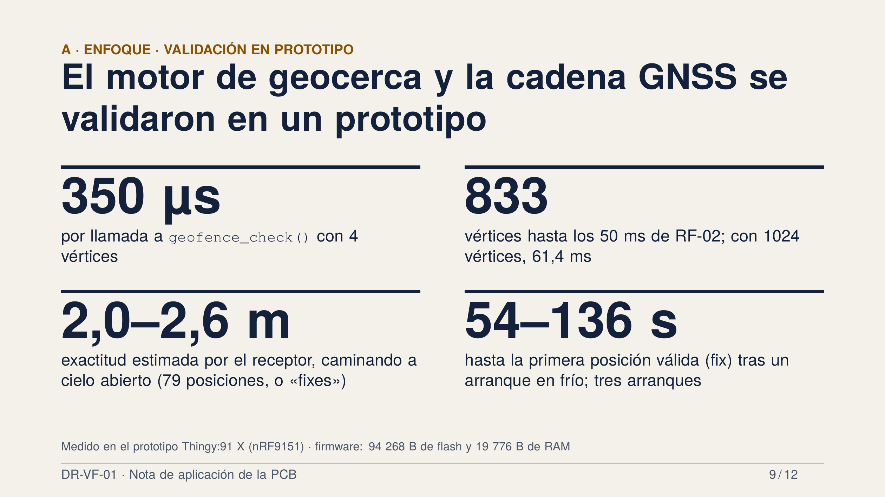
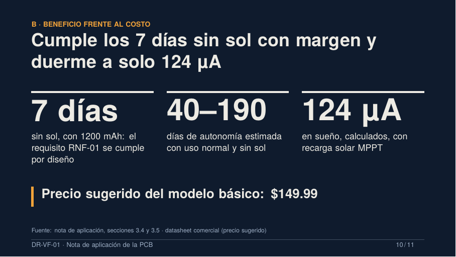

# Presentación (pitch) de la nota de aplicación

Pitch de 11 diapositivas y unos 5 minutos y medio sobre la PCB del DR-VF-01, con la estructura NABC (necesidad, enfoque, beneficio frente al costo, competencia).

- [Descargar el PDF](DR-VF-01_Pitch.pdf): en pantalla completa (F11 en el navegador, Ctrl+L en Acrobat) se pasa hoja por hoja con las flechas.
- [Descargar el PowerPoint](DR-VF-01_Pitch.pptx): se presenta con F5 y el guion aparece en las notas del orador. Cada diapositiva es una imagen; para cambiar un texto hay que editar `main.tex` y volver a generar.
- Fuentes LaTeX: [`reports/pitch/`](../../reports/pitch/)
- Las imágenes de la placa y el esquemático (hoja 1B) vienen de Altium; las medidas, de la nota de aplicación y del informe de ingeniería de la prueba de concepto (prototipo Thingy:91 X).

## Diapositivas

### 1. Portada

### 2. N · El reto de diseño

### 3. A · Arquitectura

### 4. A · La placa

### 5. A · Decisión 1: energía

### 6. A · Decisión 2: consumo

### 7. A · Decisión 3: radio y layout

### 8. A · Decisión 4: firmware

### 9. A · Validación en prototipo

### 10. B · Beneficio frente al costo

### 11. Propuesta de valor NABC

## Guion (unos 5 min 40 s)

| # | Diapositiva | Inicio | Qué decir |
|---|---|---|---|
| 1 | Portada | 0:00 | Buenas. Voy a presentar la nota de aplicación del DR-VF-01, un collar de cerca virtual para ganado. No voy a repasar la placa componente por componente: voy a mostrar las decisiones de diseño que la definen y los cálculos que las sostienen. |
| 2 | N · El reto de diseño | 0:15 | El problema de diseño son tres restricciones. Primera: el collar debe dormir casi todo el tiempo, con menos de 150 microamperios. Segunda: su única fuente de energía es un panel solar de 6 voltios y apenas uno a uno y medio vatios. Tercera: en una placa de dos capas de 2535 por 3496 mils conviven tres radios: GNSS a 1575 megahercios, LoRa a 915 y Wi-Fi a 2,4 gigahercios. |
| 3 | A · Arquitectura | 0:45 | La batería es el nodo central. Dos cargadores independientes la llenan: el CN3791 desde el panel solar y el TP4056 desde el USB-C. De ahí sale un regulador de 3,3 voltios que alimenta al procesador, al GNSS, al LoRa y a la IMU. Una decisión que parece menor y no lo es: el USB no alimenta el sistema, solo carga la batería. |
| 4 | A · La placa | 1:20 | Así se ve la placa en 3D, con 112 piezas en 2535 por 3496 mils. Cada bloque de la arquitectura tiene su lugar: el GNSS arriba, el ESP32-S3 en el centro, el LoRa a la derecha, y a la izquierda el cargador solar con su bobina, el cargador USB con el conector y la IMU. |
| 5 | A · Decisión 1: energía | 1:45 | El CN3791 busca el punto de máxima potencia del panel y ese punto lo fija un divisor de resistencias; a la derecha está el esquemático real: 390 más 10 kilohmios sobre 100, unos 6,03 voltios. La corriente la fija una resistencia de 0,47 ohmios con la referencia de 120 milivoltios: unos 255 miliamperios. Y la bobina de 47 microhenrios deja un rizado de 89 miliamperios. Descarté usar este cargador también para el USB: con 5 voltios el pin MPPT nunca llega a 1,23 voltios. |
| 6 | A · Decisión 2: consumo | 2:25 | Sumé el consumo en reposo de cada módulo: unos 124 microamperios frente al techo de 150. Tres piezas, el GNSS, el cargador solar y el regulador, suman el 82 por ciento. Por eso elegí el TLV75733P, de 25 microamperios, y no el DS8570F8, que consume 24 veces más. Sobre la autonomía sin sol hay tres cifras que responden a tres preguntas: 7 días es el requisito; de 40 a 190 días es la estimación con uso normal; y 343 días es solo el techo teórico si el collar durmiera todo el tiempo. |
| 7 | A · Decisión 3: radio y layout | 3:05 | Con solo dos capas no hay impedancia controlada: la línea de 50 ohmios es un microstrip de 53 mils sobre FR4 de 31,5, con el plano de masa continuo de la cara inferior que se ve a la derecha; de 46 a 54 ohmios con la tolerancia. Los criterios de ubicación separan el parche GNSS del Wi-Fi y del LoRa y alejan el lazo del cargador solar. Cada tipo de señal tiene su clase de red y su ancho de pista. |
| 8 | A · Decisión 4: firmware | 3:40 | Un solo código base sobre Zephyr para dos placas. Se comparte el motor de geocerca, en C puro, la máquina de estados, la alerta y el registro. Cada placa aporta sus adaptadores. Cambiar de placa es cambiar de adaptador, no de algoritmo. |
| 9 | A · Validación en prototipo | 4:05 | Validé el algoritmo y la cadena GNSS en un prototipo con el mismo código del motor. 350 microsegundos por llamada con cuatro vértices; los 50 milisegundos del requisito se alcanzan con unos 833 vértices. Caminando a cielo abierto, el receptor estimó una exactitud de 2,0 a 2,6 metros en 79 fixes. Un fix es una posición que el receptor calcula a partir de los satélites. El primer fix en frío tardó entre 54 y 136 segundos. La exactitud es la que estima el receptor, no un error medido contra una referencia. |
| 10 | B · Beneficio frente al costo | 4:35 | Sin sol, con 1200 miliamperios hora, el collar cumple el requisito de siete días y se estima entre 40 y 190 según el uso. En sueño consume unos 124 microamperios, calculados, y se recarga con el panel solar. El precio sugerido del modelo básico es 149,99. |
| 11 | Propuesta de valor NABC | 5:15 | Cierro con la propuesta de valor en cuatro frases. Necesidad: vigilar el ganado en grandes extensiones sin alambre ni red eléctrica. Enfoque: GNSS, ESP32-S3 y LoRa, con la batería central y dos cargadores. Beneficio: 124 microamperios en sueño y siete días sin sol exigidos. Competencia: frente a cercas físicas y vigilancia, el límite es un polígono en software. Gracias. |
